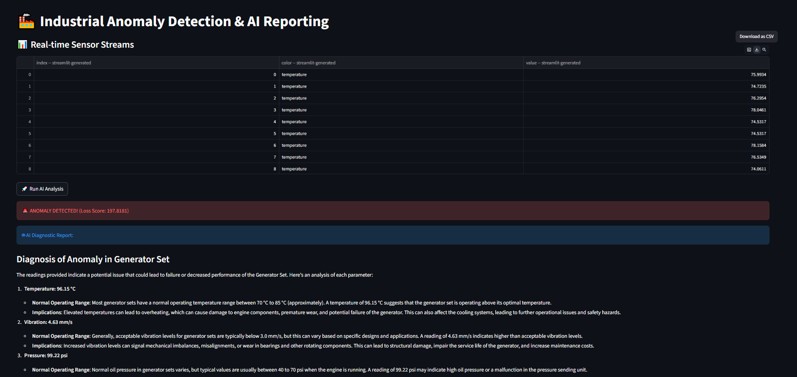
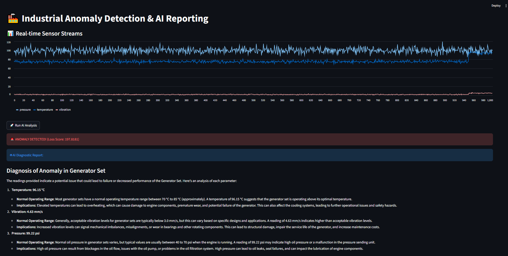
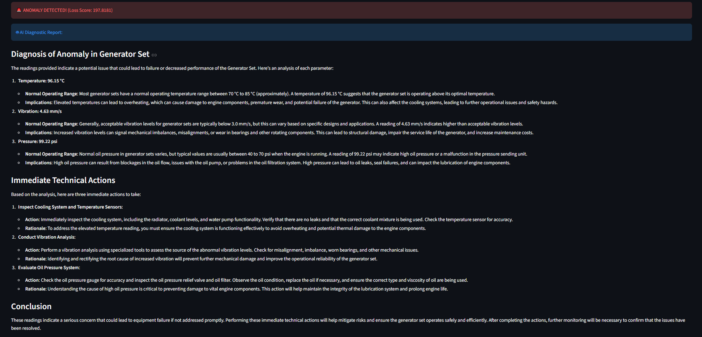

## 📊 System Dashboard & AI Insights
The pipeline monitors real-time sensor streams and triggers an alert when the Autoencoder reconstruction error exceeds the threshold.

### 1. Real-time Data Monitoring
*Viewing raw sensor logs (Temperature, Vibration, Pressure) before processing.*

### 2. Anomaly Detection & Visual Analysis
*The system detects a thermal spike and calculates a high reconstruction loss.*

### 3. AI-Powered Engineering Diagnostic Report
*LLM analyzes the numerical anomaly and generates a structured technical report.*

## 🧠 Model Performance Metrics
- **Architecture:** PyTorch Autoencoder (3 → 8 → 2 → 8 → 3 neurons).
- **Detection Result:** Successfully identified an injected fault with a **Loss Score of 197.8**.
- **Reasoning:** Large Language Model (GPT-4o-Mini) successfully correlated the 96.15°C temperature reading with potential radiator/cooling failures.